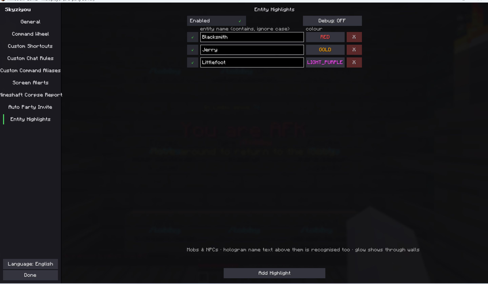
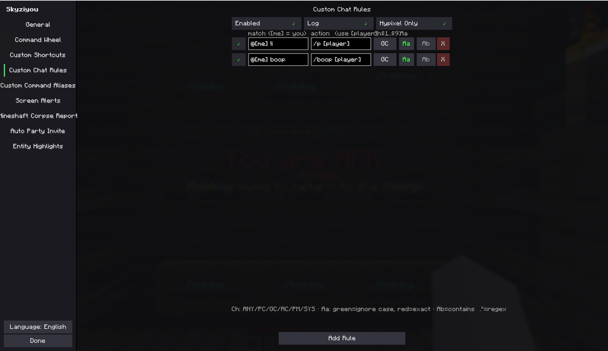

# Skyziyou

English | [简体中文](./README.md)

> This mod was generated with AI assistance; please do not use it if that bothers you.

A multi-feature Minecraft Fabric client mod (mainly for Hypixel SkyBlock): hold a customizable key to open an 8-direction radial wheel in the center of the screen, flick the mouse toward a direction to select a sector, then left click (or release the key) to quickly run a preset command or send a chat message. It also ships custom key shortcuts, user-defined command aliases, chat rules that trigger actions per chat channel, an automatic party-chat report of mineshaft corpse counts when entering a Glacial Tunnels mineshaft, and automatic party invites via private messages. Both **Minecraft 26.1 and 26.2** are supported — a single source tree builds a separate jar for each version.

## Screenshots

**In-game wheel:**


**Settings — Entity Highlights:**



**Settings — Custom Chat Rules:**



## Features

- **8-direction wheel**: Up, Up Right, Right, Down Right, Down, Down Left, Left, Up Left — each slot is independently configurable
- **Two entry types**:
  - Entries starting with `/` are executed as **commands**
  - Everything else is sent as a **chat message**
- **Two trigger modes**: left click to run, or enable "Execute On Release" to run when the trigger key is released
- **Smart interaction**:
  - The **camera is locked** while the wheel is open, so picking a sector never turns your view
  - **Vanilla mouse clicks are swallowed** while the wheel is open — no accidental attacks or block placements
  - Right click cancels anytime; the wheel auto-closes after a configurable timeout
- **Built-in category settings menu**: type `/skyziyou` or `/sz` in game; a dark SkyHanni-style layout with a left category sidebar and green ✓ / red ✕ toggles, every feature has its own sub-page, changes apply instantly and are saved on Esc/Done; the button at the bottom of the sidebar switches the interface language between **English / 中文** (settings UI only, sent chat/commands are unchanged)
- **General tab**: shows the running mod version (read from Fabric Loader by mod id, so it can never pick up another mod's metadata), GitHub links (a button opens them in the system browser), and a **manual update check** — one button queries GitHub's latest release and reports "up to date / new version available" on the page. It is strictly read-only: nothing is downloaded or installed automatically; when an update exists you open the Releases page and install it yourself
- **Custom key shortcuts**: bind any key (including mouse buttons, e.g. numpad 2) directly to a command or chat message and run it with a single press — configured in the "Custom Shortcuts" sub-page; each shortcut can be toggled on/off individually, and key conflicts are flagged in red
- **Custom Command Aliases**: rewrite a command you type into another command or a chat message — configured in the "Command Aliases" sub-page, two boxes per row
  - First box: the command you type (with or without the leading `/`, e.g. `/home`); second box: what actually runs (`/` prefix = command, otherwise chat)
  - **Exact match only** (case-insensitive): typing the alias with extra arguments does not match and the original command is sent unchanged
  - Master switch, per-row on/off toggle, and an optional local log line whenever a command is rewritten
  - Brand-new installs start with one sample alias `/pl` -> `/p leave` (removable; seeded once only while no config file exists, never re-added)
- **Screen Alerts**: when watched text appears in chat, a large centred banner pops up near the top of the screen for 4 seconds — configured in the "Screen Alerts" sub-page, two boxes per row
  - First box: chat text to watch (case-insensitive contains); second box: the banner text to display (falls back to the trigger text when blank); the row-end button restricts it to one channel (ANY / party / guild / all / private / system, ANY by default)
  - Banner text supports § colour codes and the `[player]` (sender name) / `[me]` (your name) placeholders
  - Banner font size is adjustable with −/+ on the settings page (1.0–5.0x, step 0.25) with a live preview at actual in-game size
  - Repeating the same banner just refreshes its timer instead of stacking; distinct banners stack vertically (5 at most); pure client-side HUD draw, sends no packets
- **Entity Highlights**: type a mob name in the "Entity Highlights" sub-page and every living entity whose display name contains it (case-insensitive) gets the vanilla glowing outline, **visible through walls** — handy for finding mobs or NPCs
  - Each row: on/off -> entity name -> outline colour (click to cycle 15 vanilla colours: red, gold, yellow, green, aqua, blue, light purple, white, ...) -> delete; when several rows match, the first one wins
  - Matches both the entity's own name and the **hologram text above it** (Hypixel NPC/mob names sit on invisible armour stands, e.g. the hub Blacksmith); the mob body itself is what glows
  - Pure vanilla mechanics (entity shared glow bit + client-side scoreboard team colour): no render Mixins, no packets; armour stands and your own player are skipped
  - Note: `setGlowingTag` is a no-op on the physical client, so a one-method Mixin Invoker (`EntityAccessor`) calls the protected `setSharedFlag(6, true)` directly
  - Spawn-driven matching plus a cheap full reconcile every 2 seconds as a safety net (late-arriving hologram names self-heal within 2s): only ~0.5 world passes per second in steady state, and per-tick work only maintains the small highlighted set
- **Custom Chat Rules**: match incoming chat lines by channel (ANY / party / guild / all chat / private message / system) and automatically send a reply or run a command — configured in the "Custom Chat Rules" sub-page
  - Matching: contains or full regex matching, with a per-rule **Aa** toggle for case sensitivity (case-insensitive by default; an invalid regex is reported once and then disabled automatically)
  - Actions starting with `/` run as commands; everything else is sent as a chat message
  - Placeholders: `[player]` = the sender's name, `[me]` = your own name; regex rules additionally support `$1`–`$9` capture-group substitution
  - Channel prefixes are recognized by the server-sent section colour codes, so players cannot fake party/guild lines by typing them
  - Every rule has a 3s cooldown, all actions go through a global queue throttled to one message per second (cleared on disconnect), and rules can be restricted to Hypixel only
  - Brand-new installs start with two sample guild rules: `@[me] !i` -> `/p [player]` and `@[me] boop` -> `/boop [player]` (regex mode; freely editable/removable, seeded once only)
- **Chat Sounds**: matches chat content exactly like Custom Chat Rules, but instead of running an action it **plays a built-in vanilla sound locally** (no packets, no messages) — configured in the "Chat Sounds" sub-page
  - All sounds ship with the game (XP orb "ding", note blocks, cat meow, wolf bark, level-up, bell, ender dragon and more — 23 in total): no resource pack and no audio files. Left-click the sound button to cycle, **right-click to preview instantly**
  - Each row: on/off → match text → sound → repeat count (×1–×5, ~0.25s apart) → channel (ANY/PC/GC/AC/PM/SYS) → Aa case → contains/regex; matching, the `[me]` placeholder and regex protection are identical to chat rules, with a 2s per-rule cooldown. The **Log** toggle at the top (on by default) prints a local line on every fire
- **Mineshaft Corpse Report**: right after entering a Glacial Tunnels mineshaft, reads the "Frozen Corpses" section of the tab list and sends the corpse counts per type to party chat once — configured in the "Mineshaft Corpses" sub-page
  - Detailed (default): `/pc Frozen Corpses (4): 2x Lapis, 1x Umber, 1x Vanguard`; brief: `/pc Corpses (4): 2l 1u 1vg` (l/t/u/vg = Lapis/Tungsten/Umber/Vanguard; only types present in the shaft are listed)
  - Data comes straight from tab text — **no entity scanning and no view-distance dependence**; the message is sent within about a second of the shaft loading, exactly once per mineshaft, and rearms only after leaving
  - Master switch, Hypixel-only restriction and detailed/brief format toggle (enabled by default, detailed format by default)
- **Auto Party Invite**: when a Hypixel private message contains exactly `!invite`, automatically runs `/p <player>` (60s per-player cooldown, commands queued 1s apart)

## Requirements

| Component | Version |
|---|---|
| Minecraft | **26.1.x or 26.2** (download the jar matching your game version) |
| Fabric Loader | >= 0.19.0 |
| Fabric API | latest build matching your game version |
| Fabric Language Kotlin | >= 1.13.0 |
| Java | >= 25 |

Client-side only; servers do not need to install anything.

## Installation

1. Install [Fabric Loader](https://fabricmc.net/use/installer/)
2. Download [Fabric API](https://modrinth.com/mod/fabric-api) and [Fabric Language Kotlin](https://modrinth.com/mod/fabric-language-kotlin) into your `mods` folder
3. Download the mod jar matching **your Minecraft version** from the [Releases](../../releases) page (the filename contains `mc26.1` or `mc26.2`) into your `mods` folder
4. Start the game

## Usage

1. Type `/skyziyou` (or the short form `/sz`) in game to open the settings menu and switch feature categories from the left sidebar
2. Open the **Command Wheel** sub-page, click the **Wheel Keybind** button, then press any key (or mouse button) to bind the trigger
3. Fill in the 8 input boxes with the command or message for each direction (leave a slot empty to disable it)
4. Hold the trigger key to open the wheel → flick the mouse toward a direction → left click (or release the key) to run it
5. Right click, or wait for the timeout, to close without running anything
6. Extra direct shortcuts: open the "Custom Shortcuts" sub-page, add a row and bind a key with a command (e.g. numpad 2 → `/is`)
7. Command aliases: open the "Command Aliases" sub-page; each row is **command you type → what actually runs**, e.g. `/home` → `/warp base`. A target without a leading `/` is sent as chat
8. Screen alerts: open the "Screen Alerts" sub-page; each row is **chat text to watch → banner shown on screen → watched channel**, shown for 4 seconds when matched. Use the `[player]`, `[me]` placeholders and § colour codes
9. Automated chat rules: open the "Custom Chat Rules" sub-page; each row is **match text → action (`/` prefix = command) → channel → Aa case toggle → contains/regex mode**. Use the `[player]`, `[me]` and `$1`–`$9` placeholders
10. Chat sounds: open the "Chat Sounds" sub-page; each row is **match text → sound (left-click cycles, right-click previews) → ×n repeat count → channel → Aa → contains/regex**. A vanilla sound plays locally on a match — handy for rare-drop or keyword alerts (cat meow, ding, bell...)
11. The mineshaft corpse report is enabled by default: entering a Glacial Tunnels mineshaft automatically sends the corpse counts via `/pc`; disable it or lift the Hypixel-only restriction in the "Mineshaft Corpses" sub-page
12. The `!invite` PM auto-invite is enabled by default; disable it or lift the Hypixel-only restriction in the "Auto Party Invite" sub-page
13. Entity highlights: open the "Entity Highlights" sub-page; each row is **entity name -> outline colour**; matched mobs glow and show through walls. Living mobs only (armour stands excluded)
14. All settings are stored in `.minecraft/config/skyziyou.json`; edit it manually if needed, or delete the file to reset (a legacy `commandwheel.json` is migrated automatically on first launch)

## Configuration guide and examples

Common row-list conventions on every sub-page: the leading ✓/✕ toggles that row, the red X at the end deletes it, the bottom button adds a new row, scroll when the list overflows, changes apply instantly and are saved on Esc/Done.

### Custom Chat Rules

Three master switches at the top of the page: **Enabled** (master switch), **Log** (print a local `[ChatRules] ...` line whenever a rule fires, handy for testing), and **Hypixel Only** (restrict everything to Hypixel — recommended to leave on).

Each row, left to right:

| Control | Meaning |
|---|---|
| ✓/✕ | Enable/disable this single rule |
| Match (first box) | Chat text to match |
| Action (second box) | What runs on a match: a leading `/` runs it as a command, otherwise it is sent as chat |
| Channel button (ANY/PC/GC/AC/PM/SYS) | Fire only on the chosen channel: ANY=all channels, PC=party, GC=guild, AC=all/public chat, PM=private message, SYS=system message |
| Aa | Green = ignore case, red = match case |
| `.*`/Ab | Green `.*` = regex mode, grey Ab = plain "contains text" mode |
| X | Delete this row |

Matching runs against the **message body only** (the `Party > name:` prefix and colour codes are stripped first). Channels are recognized by the server-sent section colour codes, so typing the words "Party >" into all chat cannot fake a party line.

Placeholders (available in both the match and action boxes):

- `[me]`: your own name (in the match box this lets a rule react to being mentioned)
- `[player]`: the sender's clean username (empty on SYS lines, which have no sender)
- `$1`–`$9`: regex mode only — substituted with the corresponding capture group

Examples:

| Channel | Mode | Match | Action | What it does |
|---|---|---|---|---|
| PC | contains | `!warp` | `/p warp` | When anyone in party says `!warp`, run `/p warp` to warp the party |
| GC | regex | `@[me] !i` | `/p [player]` | Someone types `@YourName !i` in guild → auto-invite them (seeded on first run) |
| GC | regex | `@[me] boop` | `/boop [player]` | Someone @s you with "boop" in guild → boop them back (seeded on first run) |
| PM | regex | `^!pay (\d+)$` | `/pay [player] $1` | A whisper `!pay 1000` → runs `/pay Sender 1000` (be careful with auto-payment rules) |
| ANY | contains | `[me] afk?` | `/pc back soon` | Anyone asks in any channel whether you are afk → reply once in party chat |

Safety: your own messages and their echoes never trigger rules; every rule has a **3s cooldown**; all actions go through a global queue at **one message per second** (32 queued messages max, cleared on disconnect) so Hypixel never sees a burst; a malformed regex is reported once in chat and auto-disabled instead of crashing the game.

### Chat Sounds

Two switches at the top: **Enabled** (master switch) and **Log** (print a local `[ChatSounds] ...` line whenever a rule fires — on by default, handy for confirming a rule works). Firing a rule only plays a sound locally — **nothing is ever sent to the server**, so there is no Hypixel-only restriction; just flip the master switch off if you do not want the alerts in single-player.

Each row, left to right:

| Control | Meaning |
|---|---|
| ✓/✕ | Enable/disable this single rule |
| Match (text box) | Chat text to match (supports the `[me]` placeholder) |
| Sound button | **Left-click** cycles through 23 vanilla sounds; **right-click** previews with the current repeat count |
| ×n button | Cycles **×1..×5**: how many times the sound plays in a row (~0.25s apart) |
| Channel button (ANY/PC/GC/AC/PM/SYS) | Same as chat rules |
| Aa | Green = ignore case, red = match case |
| `.*`/Ab | Green `.*` = regex mode, grey Ab = plain contains mode |
| X | Delete this row |

Examples:

| Channel | Mode | Match | Sound | What it does |
|---|---|---|---|---|
| SYS | contains | `RARE DROP!` | Cat Meow / Wolf Bark | An animal call alerts you on a rare drop |
| PC | contains | `[me]` | XP Orb (ding) | A soft "ding" whenever someone mentions you in party |
| ANY | regex | `\b(bingo|wither)\b` | Bell | Ring a bell on a keyword |

Safety mirrors chat rules: your own messages never trigger; every rule has a **2s cooldown** so chat spam cannot machine-gun sounds; a malformed regex is reported once and auto-disabled. Playback follows the game master volume (MASTER source, 2D with no attenuation).

### Command Aliases

Each row: ✓/✕ → the command you type (leading `/` optional) → what actually runs → X. Matching is **exact across the whole command** (case-insensitive); the alias with extra arguments does not match and the original command is sent unchanged. Only inputs starting with `/` are rewritten — use Custom Shortcuts for one-press plain chat.

| You type | Actually runs | Notes |
|---|---|---|
| `/pl` | `/p leave` | Instantly leave the party (seeded on first run) |
| `/dt` | `/warp dungeon_hub` | Shortcut to the Dungeon Hub warp |
| `/hi` | `hello everyone` | A target without `/` is sent as a chat message |

### Screen Alerts

Each row: ✓/✕ → trigger text (case-insensitive contains) → banner text (blank = show the matched text itself) → channel (ANY/PC/GC/AC/PM/SYS) → X. Banner text supports § colour codes and the `[player]` / `[me]` placeholders.

| Channel | Trigger | Banner text | What it does |
|---|---|---|---|
| PC | `warp` | `§a[player] §fstarted a warp` | Green notice naming whoever called warp in party |
| SYS | `You found` | `§6§lLoot drop!` | Big gold banner whenever a "You found …" loot line appears |
| PM | `!invite` | `§c[player] requests an invite` | Red notice for incoming invite-request whispers |

Banners stay for 4 seconds; repeated identical text refreshes the timer instead of stacking, and different banners stack up to 5; the −/+ buttons at the top set the font scale (1.0–5.0x) with a live, true-size preview below the list.

### Custom Shortcuts

Each row: ✓/✕ → keybind button (click, then press any key or mouse button) → the command or message to run → X. It runs the instant the key is pressed, e.g. numpad `2` → `/is`, `G` → `/p warp`, a mouse side button → `/hub`. Binding two shortcuts to the same key shows a red ⚠ conflict warning above the list.

### Entity Highlights

Each row: ✓/✕ → entity name (case-insensitive contains) → colour button (click to cycle 15 vanilla colours) → X. Matches both the entity's own name and the hologram text above it; when multiple rows match one entity, the **topmost row wins**. Examples:

| Name | Colour | Purpose |
|---|---|---|
| `Blacksmith` | green | The hub Blacksmith NPC |
| `Lapis Zombie` | red | Lapis zombies in the mineshaft |
| `Ice Walker` | aqua | Ice Walkers in the mineshaft |

### Auto Party Invite

Fires only when a private message body is **exactly** `!invite` (case-insensitive); `!invite please` does not match. Per-player cooldown is 60 seconds, and the command joins the same one-per-second global queue.

## Building from Source

This repository uses [Stonecutter](https://github.com/kikugie-studio/stonecutter) to manage multiple versions: one source tree produces separate jars for 26.1 and 26.2.

**JDK requirements**: any JDK 17 or newer is enough to run Gradle (the one from `JAVA_HOME` / PATH is used); the **JDK 25** needed for compilation and running the game is located automatically via the Gradle toolchain, and is provisioned through foojay if no local installation is found. No hard-coded JDK path needs to be configured.

```powershell
git clone https://github.com/orchidsziyou/Skyziyou.git
cd Skyziyou

# Windows (PowerShell) — note there must be no spaces around the colons in task names
.\gradlew.bat :26.1:build :26.2:build   # build both versions
.\gradlew.bat :26.2:build               # build only 26.2

# Linux / macOS
./gradlew :26.1:build :26.2:build
```

Build output (use the jar without the `-sources` suffix):

- 26.1: `versions/26.1/build/libs/Skyziyou-Fabric+mc26.1-<version>.jar`
- 26.2: `versions/26.2/build/libs/Skyziyou-Fabric+mc26.2-<version>.jar`

Running `./gradlew build` without a version prefix only builds the currently active version.

## Project Structure

```
src/main/
├── java/com/skyziyou/mixin/
│   ├── MixinMouseHandler.java                  # Mixin: camera lock, click swallowing, mouse delta capture
│   ├── EntityAccessor.java                     # Mixin Invoker: setSharedFlag(6) to glow entities client-side
│   └── ClientCommonPacketListenerAccessor.java # Server brand accessor (Hypixel detection)
├── kotlin/com/skyziyou/
│   ├── SkyziyouMod.kt          # Mod entrypoint: config, renderer, event registration
│   ├── ConfigScreen.kt         # Category registry + BaseConfigScreen sidebar shell
│   ├── SkyWidgets.kt           # Dark-theme widgets: SkyButton / SkyToggle (✓/✕)
│   ├── GeneralScreen.kt        # General tab: version / GitHub links / update check entry
│   ├── UpdateChecker.kt        # Read-only GitHub latest-release query (background, no auto-download)
│   ├── WheelState.kt           # Core wheel state machine: open/select/close/execute
│   ├── WheelRenderer.kt        # HUD rendering: scanline disc + text labels
│   ├── SkyziyouConfig.kt       # JSON config I/O (atomic writes, legacy config migration)
│   ├── WheelConfigScreen.kt    # Command Wheel settings sub-page
│   ├── Shortcuts.kt / ShortcutsScreen.kt       # Custom key shortcuts
│   └── features/
│       ├── ActionQueue.kt      # Global command/chat throttle queue (1 per second, cleared on disconnect)
│       ├── chat/               # Unified chat channel classifier + custom chat rules
│       │   ├── ChatChannel.kt / ChatClassifier.kt
│       │   └── ChatRulesFeature.kt / ChatRulesScreen.kt
│       ├── sound/              # Chat-triggered playback of built-in vanilla sounds (curated list)
│       │   ├── SoundLibrary.kt / ChatSounds.kt
│       │   └── ChatSoundsScreen.kt
│       ├── command/            # Custom command aliases (typed-command rewrite)
│       │   └── CommandAliases.kt / CommandAliasesScreen.kt
│       ├── alert/              # Chat-keyword triggered centred screen banners
│       │   └── ScreenAlerts.kt / ScreenAlertsScreen.kt
│       ├── mineshaft/          # Reads tab corpse widget on shaft entry, reports via /pc
│       │   └── MineshaftCorpseReporter.kt / MineshaftCorpseScreen.kt
│       ├── party/
│       │   ├── AutoInviteFeature.kt        # !invite PM auto party invite
│       │   └── AutoInviteConfigScreen.kt   # Settings sub-page for that feature
│       └── highlight/                      # Entity glow highlights (name+hologram fusion, fake-team colours)
│           └── EntityHighlights.kt / EntityHighlightsScreen.kt
└── resources/
    └── skyziyou.mixins.json    # Mixin config (version-specific fabric.mod.json lives under versions/)

versions/26.1/src/main/resources/fabric.mod.json   # 26.1 mod metadata (depends on ~26.1)
versions/26.2/src/main/resources/fabric.mod.json   # 26.2 mod metadata (depends on ~26.2)
settings.gradle.kts / stonecutter.gradle.kts       # Stonecutter multi-version build configuration
```

## License

[MIT](LICENSE)
