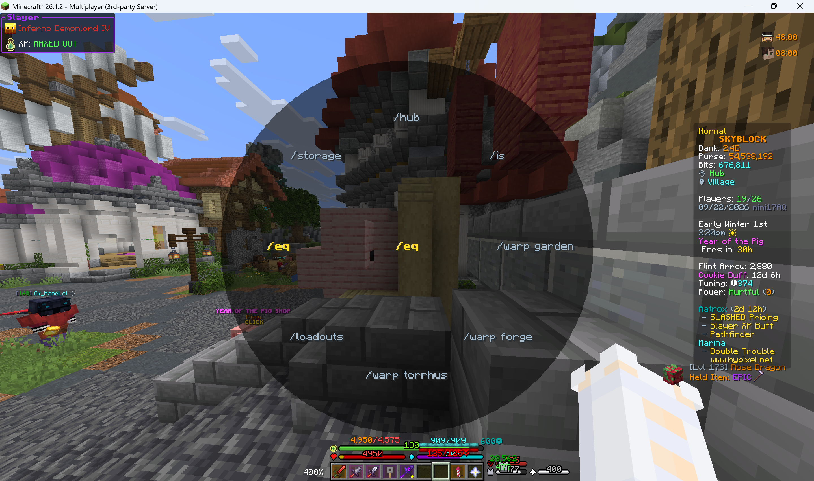
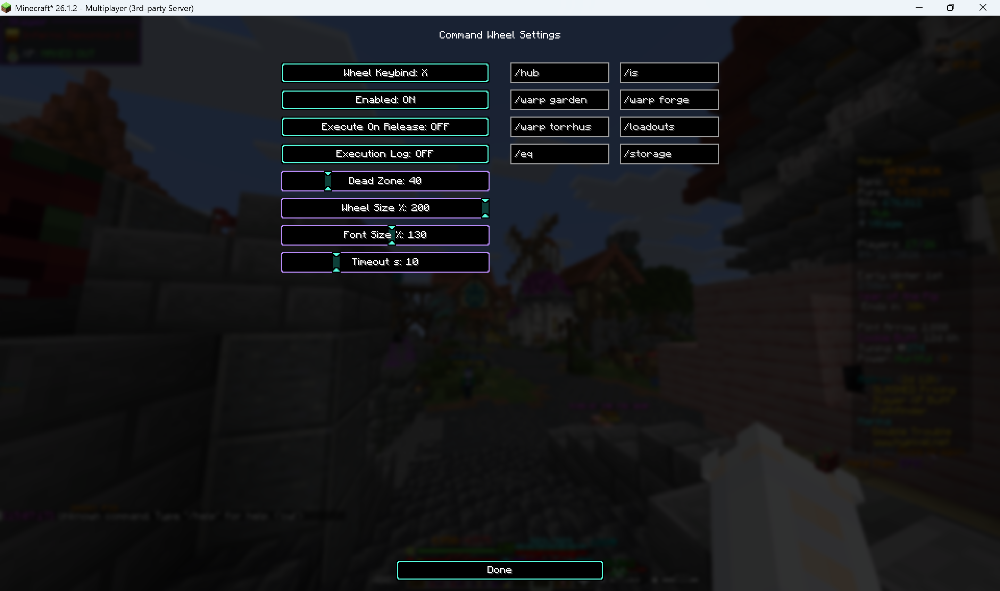

# Skyziyou

English | [简体中文](./README.md)

> This mod was generated with AI assistance; please do not use it if that bothers you.

A multi-feature Minecraft Fabric client mod (mainly for Hypixel SkyBlock): hold a customizable key to open an 8-direction radial wheel in the center of the screen, flick the mouse toward a direction to select a sector, then left click (or release the key) to quickly run a preset command or send a chat message. It also ships custom key shortcuts, user-defined command aliases, chat rules that trigger actions per chat channel, an automatic party-chat report of mineshaft corpse counts when entering a Glacial Tunnels mineshaft, and automatic party invites via private messages. Both **Minecraft 26.1 and 26.2** are supported — a single source tree builds a separate jar for each version.

## Screenshots

**In-game wheel:**



**Settings screen:**



## Features

- **8-direction wheel**: Up, Up Right, Right, Down Right, Down, Down Left, Left, Up Left — each slot is independently configurable
- **Two entry types**:
  - Entries starting with `/` are executed as **commands**
  - Everything else is sent as a **chat message**
- **Two trigger modes**: left click to run, or enable "Execute On Release" to run when the trigger key is released
- **Smart interaction**:
  - The **camera is locked** while the wheel is open, so picking a sector never turns your view
  - **Vanilla mouse clicks are swallowed** while the wheel is open — no accidental attacks or block placements
  - Right click cancels anytime; the wheel auto-closes after a configurable timeout
- **Built-in category settings menu**: type `/skyziyou` or `/sz` in game; every feature has its own sub-page, changes apply instantly and are saved on close
- **Custom key shortcuts**: bind any key (including mouse buttons, e.g. numpad 2) directly to a command or chat message and run it with a single press — configured in the "Custom Shortcuts" sub-page; each shortcut can be toggled on/off individually, and key conflicts are flagged in red
- **Custom Command Aliases**: rewrite a command you type into another command or a chat message — configured in the "Command Aliases" sub-page, two boxes per row
  - First box: the command you type (with or without the leading `/`, e.g. `/home`); second box: what actually runs (`/` prefix = command, otherwise chat)
  - **Exact match only** (case-insensitive): typing the alias with extra arguments does not match and the original command is sent unchanged
  - Master switch, per-row on/off toggle, and an optional local log line whenever a command is rewritten
- **Screen Alerts**: when watched text appears in chat, a large centred banner pops up near the top of the screen for 4 seconds — configured in the "Screen Alerts" sub-page, two boxes per row
  - First box: chat text to watch (case-insensitive contains); second box: the banner text to display (falls back to the trigger text when blank); the row-end button restricts it to one channel (ANY / party / guild / all / private / system, ANY by default)
  - Banner text supports § colour codes and the `[player]` (sender name) / `[me]` (your name) placeholders
  - Banner font size is adjustable with −/+ on the settings page (1.0–5.0x, step 0.25) with a live preview at actual in-game size
  - Repeating the same banner just refreshes its timer instead of stacking; distinct banners stack vertically (5 at most); pure client-side HUD draw, sends no packets
- **Custom Chat Rules**: match incoming chat lines by channel (ANY / party / guild / all chat / private message / system) and automatically send a reply or run a command — configured in the "Custom Chat Rules" sub-page
  - Matching: contains or full regex matching, with a per-rule **Aa** toggle for case sensitivity (case-insensitive by default; an invalid regex is reported once and then disabled automatically)
  - Actions starting with `/` run as commands; everything else is sent as a chat message
  - Placeholders: `[player]` = the sender's name, `[me]` = your own name; regex rules additionally support `$1`–`$9` capture-group substitution
  - Channel prefixes are recognized by the server-sent section colour codes, so players cannot fake party/guild lines by typing them
  - Every rule has a 3s cooldown, all actions go through a global queue throttled to one message per second (cleared on disconnect), and rules can be restricted to Hypixel only
- **Mineshaft Corpse Report**: right after entering a Glacial Tunnels mineshaft, reads the "Frozen Corpses" section of the tab list and sends the corpse counts per type to party chat once — configured in the "Mineshaft Corpses" sub-page
  - Detailed (default): `/pc Frozen Corpses (4): 2x Lapis, 1x Umber, 1x Vanguard`; brief: `/pc Corpses (4): 2l 1u 1vg` (l/t/u/vg = Lapis/Tungsten/Umber/Vanguard; only types present in the shaft are listed)
  - Data comes straight from tab text — **no entity scanning and no view-distance dependence**; the message is sent within about a second of the shaft loading, exactly once per mineshaft, and rearms only after leaving
  - Master switch, Hypixel-only restriction and detailed/brief format toggle (enabled by default, detailed format by default)
- **Auto Party Invite**: when a Hypixel private message contains exactly `!invite`, automatically runs `/p <player>` (60s per-player cooldown, commands queued 1s apart)

## Requirements

| Component | Version |
|---|---|
| Minecraft | **26.1.x or 26.2** (download the jar matching your game version) |
| Fabric Loader | >= 0.19.0 |
| Fabric API | latest build matching your game version |
| Fabric Language Kotlin | >= 1.13.0 |
| Java | >= 25 |

Client-side only; servers do not need to install anything.

## Installation

1. Install [Fabric Loader](https://fabricmc.net/use/installer/)
2. Download [Fabric API](https://modrinth.com/mod/fabric-api) and [Fabric Language Kotlin](https://modrinth.com/mod/fabric-language-kotlin) into your `mods` folder
3. Download the mod jar matching **your Minecraft version** from the [Releases](../../releases) page (the filename contains `mc26.1` or `mc26.2`) into your `mods` folder
4. Start the game

## Usage

1. Type `/skyziyou` (or the short form `/sz`) in game to open the settings category menu
2. Open the **Command Wheel** sub-page, click the **Wheel Keybind** button, then press any key (or mouse button) to bind the trigger
3. Fill in the 8 input boxes with the command or message for each direction (leave a slot empty to disable it)
4. Hold the trigger key to open the wheel → flick the mouse toward a direction → left click (or release the key) to run it
5. Right click, or wait for the timeout, to close without running anything
6. Extra direct shortcuts: open the "Custom Shortcuts" sub-page, add a row and bind a key with a command (e.g. numpad 2 → `/is`)
7. Command aliases: open the "Command Aliases" sub-page; each row is **command you type → what actually runs**, e.g. `/home` → `/warp base`. A target without a leading `/` is sent as chat
8. Screen alerts: open the "Screen Alerts" sub-page; each row is **chat text to watch → banner shown on screen → watched channel**, shown for 4 seconds when matched. Use the `[player]`, `[me]` placeholders and § colour codes
9. Automated chat rules: open the "Custom Chat Rules" sub-page; each row is **match text → action (`/` prefix = command) → channel → Aa case toggle → contains/regex mode**. Use the `[player]`, `[me]` and `$1`–`$9` placeholders
10. The mineshaft corpse report is enabled by default: entering a Glacial Tunnels mineshaft automatically sends the corpse counts via `/pc`; disable it or lift the Hypixel-only restriction in the "Mineshaft Corpses" sub-page
11. The `!invite` PM auto-invite is enabled by default; disable it or lift the Hypixel-only restriction in the "Auto Party Invite" sub-page
12. All settings are stored in `.minecraft/config/skyziyou.json`; edit it manually if needed, or delete the file to reset (a legacy `commandwheel.json` is migrated automatically on first launch)

## Building from Source

This repository uses [Stonecutter](https://github.com/kikugie-studio/stonecutter) to manage multiple versions: one source tree produces separate jars for 26.1 and 26.2.

**JDK requirements**: any JDK 17 or newer is enough to run Gradle (the one from `JAVA_HOME` / PATH is used); the **JDK 25** needed for compilation and running the game is located automatically via the Gradle toolchain, and is provisioned through foojay if no local installation is found. No hard-coded JDK path needs to be configured.

```powershell
git clone https://github.com/orchidsziyou/Skyziyou.git
cd Skyziyou

# Windows (PowerShell) — note there must be no spaces around the colons in task names
.\gradlew.bat :26.1:build :26.2:build   # build both versions
.\gradlew.bat :26.2:build               # build only 26.2

# Linux / macOS
./gradlew :26.1:build :26.2:build
```

Build output (use the jar without the `-sources` suffix):

- 26.1: `versions/26.1/build/libs/Skyziyou-Fabric+mc26.1-<version>.jar`
- 26.2: `versions/26.2/build/libs/Skyziyou-Fabric+mc26.2-<version>.jar`

Running `./gradlew build` without a version prefix only builds the currently active version.

## Project Structure

```
src/main/
├── java/com/skyziyou/mixin/
│   ├── MixinMouseHandler.java                  # Mixin: camera lock, click swallowing, mouse delta capture
│   └── ClientCommonPacketListenerAccessor.java # Server brand accessor (Hypixel detection)
├── kotlin/com/skyziyou/
│   ├── SkyziyouMod.kt          # Mod entrypoint: config, renderer, event registration
│   ├── ConfigScreen.kt         # Settings category menu + BaseConfigScreen base class
│   ├── WheelState.kt           # Core wheel state machine: open/select/close/execute
│   ├── WheelRenderer.kt        # HUD rendering: scanline disc + text labels
│   ├── SkyziyouConfig.kt       # JSON config I/O (atomic writes, legacy config migration)
│   ├── WheelConfigScreen.kt    # Command Wheel settings sub-page
│   ├── Shortcuts.kt / ShortcutsScreen.kt       # Custom key shortcuts
│   └── features/
│       ├── ActionQueue.kt      # Global command/chat throttle queue (1 per second, cleared on disconnect)
│       ├── chat/               # Unified chat channel classifier + custom chat rules
│       │   ├── ChatChannel.kt / ChatClassifier.kt
│       │   └── ChatRulesFeature.kt / ChatRulesScreen.kt
│       ├── command/            # Custom command aliases (typed-command rewrite)
│       │   └── CommandAliases.kt / CommandAliasesScreen.kt
│       ├── alert/              # Chat-keyword triggered centred screen banners
│       │   └── ScreenAlerts.kt / ScreenAlertsScreen.kt
│       ├── mineshaft/          # Reads tab corpse widget on shaft entry, reports via /pc
│       │   └── MineshaftCorpseReporter.kt / MineshaftCorpseScreen.kt
│       └── party/
│           ├── AutoInviteFeature.kt        # !invite PM auto party invite
│           └── AutoInviteConfigScreen.kt   # Settings sub-page for that feature
└── resources/
    └── skyziyou.mixins.json    # Mixin config (version-specific fabric.mod.json lives under versions/)

versions/26.1/src/main/resources/fabric.mod.json   # 26.1 mod metadata (depends on ~26.1)
versions/26.2/src/main/resources/fabric.mod.json   # 26.2 mod metadata (depends on ~26.2)
settings.gradle.kts / stonecutter.gradle.kts       # Stonecutter multi-version build configuration
```

## License

[MIT](LICENSE)
